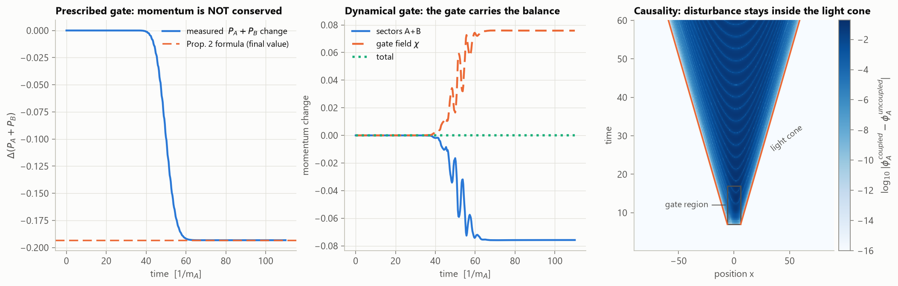
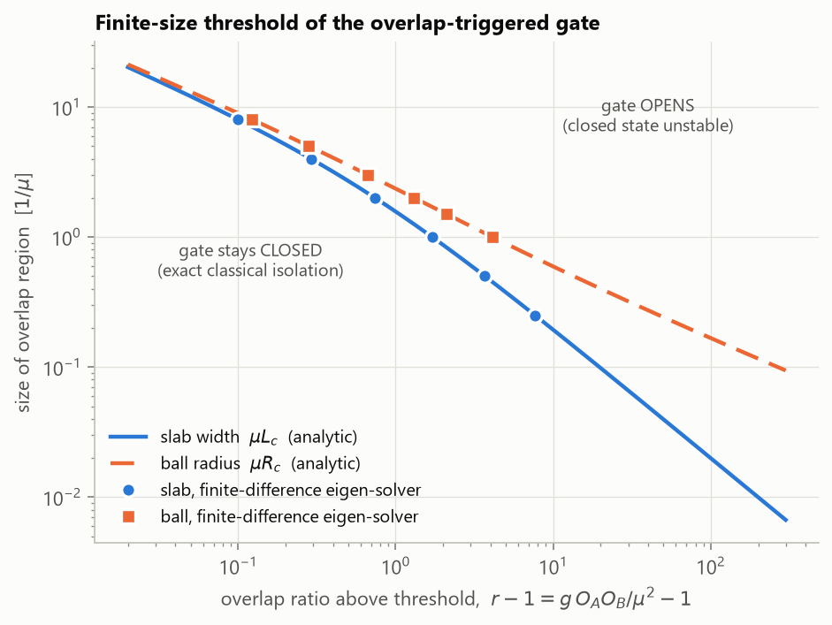
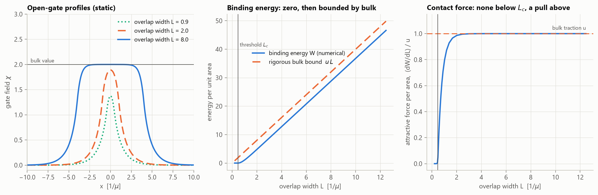
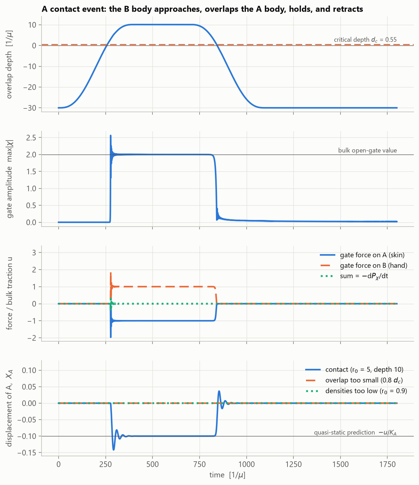
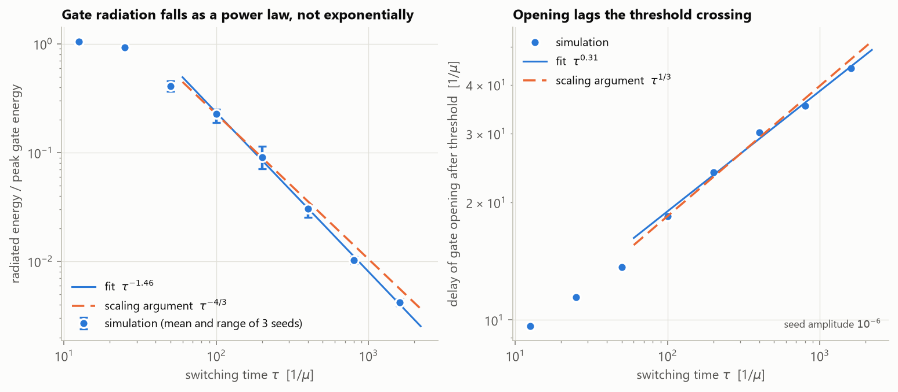
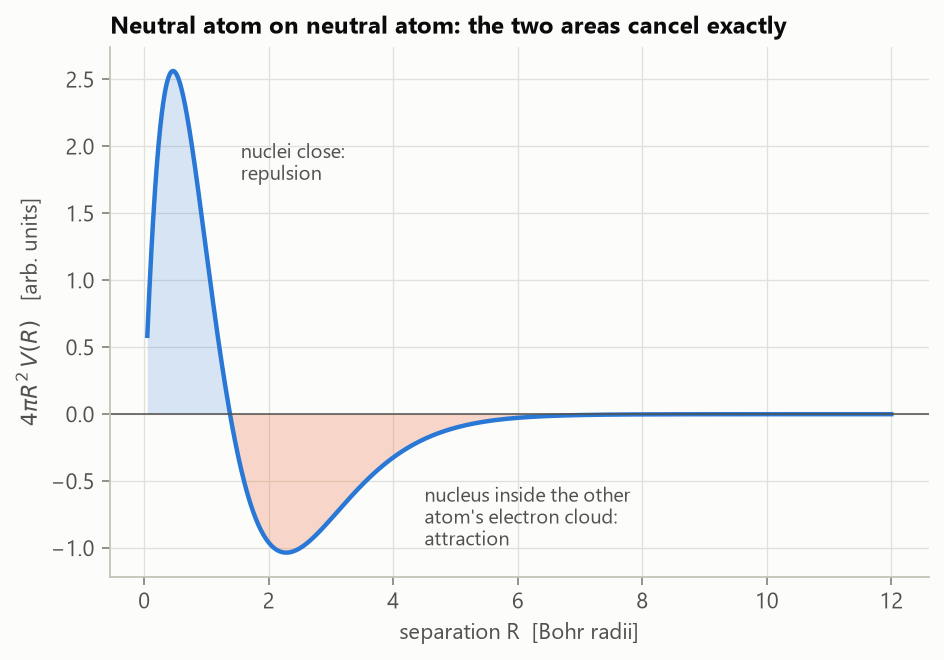

# Co-located sectors with gated product portals: isolation, transient contact, and what it takes to be felt

**Project CRH — mathematical manuscript (working paper, not peer reviewed)**

> **Status of this document.** This is the output of an AI-conducted theoretical study. The mathematics is elementary classical and effective field theory; every displayed identity that could be checked by computer algebra or by numerical experiment has been (see the verification table in §11 and the code in `03_computation/`). Nothing here has been reviewed by a physicist. No observation of any "other reality" exists, and nothing in this document is evidence that one does. Statements labelled **Theorem/Proposition/Lemma** are proved here under stated assumptions; statements labelled **Estimate** are order-of-magnitude arguments; statements attributed to the literature are flagged with their verification status in `01_literature_review/`.

## Abstract

We ask whether two physically distinct sets of fields and observers ("sectors" A and B) can share one spacetime, be ordinarily unable to interact, and nevertheless exchange a small, local, transient mechanical impulse — something an observer could feel. (1) We show that "co-located but completely non-interacting" is not a meaningful statement: without at least one shared field the identification of points between the sectors is pure gauge. With a single metric the shared field is gravity, sector B is dark matter for sector A, and geophysical data cap a co-located second world at 0.4 % of the Earth's mass. (2) Any switchable coupling must be a dynamical "gate" field; a prescribed switch violates energy–momentum conservation by an amount we give in closed form and confirm numerically. (3) For portals in which each sector couples separately to mediators we prove a positivity bound, $F_{AB}^2\le F_{AA}F_{BB}$, so a strong cross-sector force with no anomalous same-sector force requires either enormous self-forces in sector B or a *product portal* $F(\chi)\,O_AO_B$. (4) We derive the coupling a coherent contact force needs in order to reach human perception: about $2\times10^{4}$ times the Fermi constant at water density. Weak-scale exchange, the Higgs portal and photon kinetic mixing all fall short by at least four orders of magnitude; for kinetic mixing the first-order mean field between neutral bodies vanishes identically. A touch-strength contact coupling would also put the overlapping bodies in thermal contact within seconds or less. (5) We construct an *overlap-triggered gate*: a scalar that condenses only where matter of both sectors is co-present. Below a finite-size threshold the sectors are exactly decoupled at the classical level; above it the gate produces a bounded, attractive contact force, closes again when the overlap ends, and radiates a fraction of its energy that falls as a power law $\propto(\mu\tau)^{-4/3}$ in the switching time. The construction meets every requirement of the thought experiment as a classical effective theory. It fails as a natural quantum theory: the zero of an even gate cannot be protected by symmetry, all contact realizations need new physics coupled to nucleons between the keV and GeV scales, and the attractive sign that a self-triggered gate necessarily has raises an unexamined danger of cross-sector nuclear bound states. A gate that lets a hand feel a hand would also let it feel the ground, so the scenario is at best one of rare visitors, not co-resident worlds. We classify the outcome as *interesting but incomplete*.

---

## 1. The problem

### 1.1 The thought experiment as a list of requirements

An observer in reality A stands in a room. At the corresponding place in reality B another observer extends a hand. For a moment the A observer feels something like a touch. Then it stops. We translate this into requirements on a physical theory:

| | Requirement | Mathematical meaning |
|---|---|---|
| R0 | Co-location | A and B fields live on one manifold, and "the same place" is physically meaningful |
| R1 | Ordinary isolation | In ordinary conditions the cross-coupling is absent or negligible |
| R2 | Locality of the event | The direct coupling is non-zero only in a bounded spacetime region; anything else propagates causally |
| R3 | No runaway | The event does not grow, spread without limit, or destabilise the vacuum |
| R4 | No permanent connection | After the event the coupling returns to zero |
| R5 | Conservation | Total energy and momentum are conserved, including whatever switches the coupling |
| R6 | Perceptibility | The momentum transfer reaches the threshold of a human mechanoreceptor |
| R7 | Coincidence | A B-sector body is in fact present at the A observer's location, nearly at rest relative to it |

R6 and R7 are not stated in the thought experiment but are implied by it, and they turn out to be the hardest.

### 1.2 Conventions

Signature $(+,-,-,-)$, $\hbar=c=1$ unless units are shown. "Sector" means a set of fields $\Phi_A$ or $\Phi_B$ with its own action. $O_A$, $O_B$ denote local scalar operators built from one sector only. $n_A$, $n_B$ are nucleon-like number densities. The Fermi constant is $G_F=1.166\times10^{-5}\ \mathrm{GeV^{-2}}$. Numbers quoted without derivation are produced by `03_computation/exp6_touch_numbers.py`.

### 1.3 Summary of results

1. **Lemma 1** — co-location requires a shared field (§2.2).
2. **Corollary 1** — with one metric, a co-located second world has mean density below 21 kg/m³ (§2.3).
3. **Propositions 1–3** — balance laws for gated portals, the conservation failure of prescribed gates, and a classification of gates (§3).
4. **Theorem 1** — positivity bound on factorized portals (§4).
5. **Proposition 4, Lemma 2, Proposition 5** — the touch bound; cancellation of the kinetic-mixing mean field; the thermal-contact corollary (§5).
6. **Theorems 2–3** — exact isolation and finite-size threshold of the overlap-triggered gate; attraction and the bulk bound (§6).
7. **Scaling law** — power-law gate radiation (§6.5), with numerical support.
8. **Proposition 6** — an even gate's zero cannot be symmetry-protected; an odd gate's can (§6.7).

---

## 2. Kinematics: what "co-located" means

### 2.1 Setup

Let $\mathcal M$ be a four-dimensional manifold. Sector A consists of fields $\Phi_A$ and a metric $g^A_{\mu\nu}$ to which they couple; sector B of $\Phi_B$ and $g^B_{\mu\nu}$. We allow for the moment that the two metrics differ.

### 2.2 Co-location is not free

**Lemma 1 (co-location requires a shared field).** Suppose the action is a sum $S=S_A[\Phi_A,g^A]+S_B[\Phi_B,g^B]$ with each term generally covariant and no field appearing in both. Then

1. the theory is invariant under $\mathrm{Diff}(\mathcal M)\times\mathrm{Diff}(\mathcal M)$, the two factors acting independently on the two sectors;
2. no observable depends on which point of the A description is identified with which point of the B description; in particular "a B body is at the location of an A body" has no invariant meaning;
3. any term that makes the identification meaningful depends on fields of both sectors at a common point and is therefore an interaction between them.

*Proof.* (1) Each term is invariant under diffeomorphisms acting on its own fields. (2) Let $\psi$ be a diffeomorphism and act with it on sector A only: $(\Phi_A,g^A)\mapsto(\psi^*\Phi_A,\psi^*g^A)$. Solutions map to solutions. Every observable of sector A is a diffeomorphism-invariant functional of sector-A fields, hence unchanged, and likewise for B. The coincidence relation between an A event at $p$ and a B event at $p$ is mapped to a relation between $\psi^{-1}(p)$ and $p$. Since $\psi$ is arbitrary and nothing observable has changed, coincidence is not observable. (3) A functional that distinguishes the identity map between the descriptions from $\psi$ must depend on both sets of fields at related points; added to the action it couples the sectors and breaks the symmetry to the diagonal $\mathrm{Diff}(\mathcal M)$. $\square$

*Remarks.* (a) This is a re-statement, for the present purpose, of a structure well known from "gravity in theory space" [AGS03] and bimetric theory. We claim no originality for it beyond the application. (b) The lemma disposes of the strongest form of the hypothesis: two realities on the same spacetime that do not interact *at all*, not even gravitationally, are not "on the same spacetime" in any physical sense. (c) The minimal shared structure is the metric itself.

### 2.3 One metric: gravity is shared, and what follows

If $g^A=g^B=g$, then by Weinberg's theorem [Weinberg64] the single massless graviton couples to all energy-momentum with one strength. Sector B gravitates. Four consequences bear on requirement R7.

**(i) B is dark matter for A, and conversely.** Each sector's matter appears in the other's gravitational observations. A sector able to form planets must dissipate, and a dissipative component is viable only as a subdominant part of the dark matter — comparable to the baryon fraction in the scenario of [FanKatzRandallReece13].

**(ii) Corollary 1 (the twin world must be very light).** Geophysical data bound any gravitating-only matter inside the Earth by $M_B<3.8\times10^{-3}M_\oplus$ [IgnatievVolkas00]. Hence a B-sector world whose surface coincides with the Earth's surface has mean density

$$\bar\rho_B<3.8\times10^{-3}\times5513\ \mathrm{kg/m^3}\approx 21\ \mathrm{kg/m^3},$$

about 2 % of the density of water. Its material must nevertheless support itself in the *Earth's* gravitational field, a pressure scale $\bar\rho_B\,g\,R_\oplus\sim10^{9}$ Pa. A B observer standing on such a world weighs what we weigh, and would infer an enormous invisible mass beneath the ground: us. An Earth-like twin planet at the same location is excluded by two and a half orders of magnitude in mass. Outside the Earth, hidden matter bound between satellite and lunar orbits is below $4\times10^{-9}M_\oplus$ [Adler08].

**(iii) Nothing aligns the two worlds.** With only gravity acting between them, there is no dissipative mechanism that locks the rotation of a B world to the Earth's. Generic relative speeds at the surface are then of the order of rotational speeds (hundreds of metres per second), not the near-zero relative velocity that "extends a hand" requires. We have not estimated gravitational spin–spin locking between non-axisymmetric bodies; it would have to do all the work.

**(iv) Cosmology.** Light species in sector B add to the radiation density; the sector must be colder than ours [BCV01].

None of these is new physics. Together they say that under shared gravity R7 is satisfiable only by a contrived, extremely tenuous co-rotating twin, or by a *visitor* rather than a resident — a B body that happens to pass through.

### 2.4 Two metrics: the bimetric alternative

Two massless gravitons cannot be coupled [BDGH01], and by Lemma 1 two uncoupled metrics give no co-location. The remaining option is a ghost-free bimetric theory [HassanRosen12] in which A matter couples to $g$ with Planck mass $M_g$ and B matter to $f$ with Planck mass $M_f$ (the same matter coupled to both metrics re-introduces a ghost [deRhamHeisenbergRibeiro15]). Linearising about proportional backgrounds with canonically normalised perturbations $h$, $\ell$, the mass eigenstates are

$$u=\frac{M_g h+M_f \ell}{M_{\rm eff}},\qquad v=\frac{M_g \ell-M_f h}{M_{\rm eff}},\qquad M_{\rm eff}^2=M_g^2+M_f^2 ,$$

and the source term $hT_A/M_g+\ell T_B/M_f$ becomes

$$\frac{1}{M_{\rm eff}}\Big[u\,(T_A+T_B)+v\,\big(-\alpha\,T_A+\alpha^{-1}T_B\big)\Big],\qquad \alpha=\frac{M_f}{M_g}.$$

The massless mode $u$ couples universally, as Weinberg's theorem demands; the massive mode $v$ (mass $m$) couples with opposite relative sign. For static sources a massive spin-2 exchange carries the weight $4/3$ relative to a massless one, so in the linear regime

$$V_{AA}\propto-\frac1r\Big(1+\tfrac43\alpha^{2}e^{-mr}\Big),\qquad V_{BB}\propto-\frac1r\Big(1+\tfrac43\alpha^{-2}e^{-mr}\Big),\qquad V_{AB}\propto-\frac1r\Big(1-\tfrac43e^{-mr}\Big).$$

(Verified symbolically, check S6.) At $r\gg1/m$ gravity is universal. At $r\ll1/m$, where non-linear screening of the helicity-0 mode replaces $4/3\to1$, the cross-sector potential cancels: the sectors do not see each other gravitationally. A model of this kind for mirror matter, using a Lorentz-breaking phase to obtain a clean Yukawa form, is [BNPR09]. With $1/m$ between planetary and galactic scales, a co-located B world would evade Corollary 1 while B matter still acted as dark matter on large scales.

**The cost.** By Lemma 1 the identification of A points with B points is now carried by a dynamical link (Stückelberg) field, whose self-interactions become strong at the scale $\Lambda_3=(m^2M_{\rm Pl})^{1/3}$. In vacuum $\Lambda_3^{-1}\approx0.1$ mm for $1/m=1$ AU, 40 m for 1 kpc, and $10^{3}$ km for the Hubble radius. For long graviton Compton wavelengths the notion of "the corresponding room" lies outside the regime of validity of the effective theory. We regard the bimetric route as a legitimate but unexplored loophole and do not build on it. (The $\Lambda_3$ values are standard dimensional analysis; how sources redress the cutoff was not studied here.)

---

## 3. Gated portals: structure and conservation laws

### 3.1 The action

Take a single metric. A coupling that can be "off" or "on" depending on place and time must be controlled by something. We write

$$S=S_{\rm grav}[g]+S_A[\Phi_A,g]+S_B[\Phi_B,g]+S_\chi[\chi,g]-\int d^4x\sqrt{-g}\;F(\chi)\,O_A\,O_B ,\tag{3.1}$$

where $\chi$ is a real scalar "gate" field and $F$ a function with $F(\chi_0)=0$ at the vacuum value $\chi_0$. We call the last term a **product portal**: the sectors meet only through the product $O_AO_B$. It is *not* of the more familiar factorized form $\sigma\,(g_AO_A+g_BO_B)$; the distinction is the subject of §4.

### 3.2 Balance laws

Let $T_X^{\mu\nu}$ be the stress tensor of $S_X$ alone ($X=A,B,\chi$), in flat space.

**Proposition 1 (balance laws).** On solutions of (3.1), for operators $O_X$ that depend on the fields but not their derivatives,

$$\partial_\mu T_A^{\mu\nu}=-F\,O_B\,\partial^\nu O_A,\qquad \partial_\mu T_B^{\mu\nu}=-F\,O_A\,\partial^\nu O_B,\qquad \partial_\mu T_\chi^{\mu\nu}=-O_AO_B\,\partial^\nu F ,\tag{3.2}$$

and with $T_{\rm int}^{\mu\nu}=\eta^{\mu\nu}F\,O_AO_B$ the total $T_A+T_B+T_\chi+T_{\rm int}$ is conserved. In particular the force on sector-A matter is

$$\frac{d\mathbf P_A}{dt}=-\int d^3x\;O_A\,\nabla\big(F\,O_B\big),\tag{3.3}$$

i.e. A matter with "charge density" $O_A$ moves in the potential $F\,O_B$, and

$$\frac{d}{dt}\big(\mathbf P_A+\mathbf P_B+\mathbf P_\chi\big)=0 .\tag{3.4}$$

*Proof.* For a scalar, $\partial_\mu T^{\mu\nu}=(\Box\phi+V')\partial^\nu\phi$ and the field equation gives $\Box\phi_A+V_A'=-F\,O_B\,O_A'(\phi_A)$; the other two follow in the same way, and the three right-hand sides sum to $-\partial^\nu(FO_AO_B)$. $\square$ (Computer-algebra check S1–S2; numerical check Experiment 1b.)

Equation (3.4) is Newton's third law for a contact event: the two bodies' momentum changes are equal and opposite *up to the momentum carried by the gate*.

### 3.3 A prescribed switch is not allowed

**Proposition 2 (prescribed gates violate conservation).** If $F$ is replaced by a fixed function $f(t,\mathbf x)$, then

$$\Delta(\mathbf P_A+\mathbf P_B)=-\int d^4x\;(\nabla f)\,O_AO_B,\qquad \Delta(E_A+E_B+E_{\rm int})=+\int d^4x\;(\partial_tf)\,O_AO_B .\tag{3.5}$$

*Proof.* Set $\partial^\nu F\to\partial^\nu f$ in (3.2) and integrate. $\square$ (Check S3; Experiment 1a reproduces both integrals to relative accuracy $6\times10^{-4}$ and $1\times10^{-5}$ with second-order convergence.)

So "the interaction becomes temporarily non-zero within a bounded region" cannot be imposed by hand without an external agent that supplies exactly the energy and momentum in (3.5). In a closed theory that agent is the gate field, and then the gate's own energy, sourcing and fate are part of the problem.

### 3.4 Classification of gates

Expand about the vacuum: $F(\chi_0+\delta)=F_1\delta+\tfrac12F_2\delta^2+\dots$, and let $\chi$ have mass $\mu$.

**Proposition 3 (three kinds of gate).**

- **(a) Odd (sourced) gate, $F_1\neq0$.** Matter overlap sources the gate: for static, slowly varying matter $\delta=-F_1O_AO_B/\mu^2$ and the interaction energy density is $-F_1^2(O_AO_B)^2/2\mu^2$. The coupling is never exactly off; it is suppressed because it is *quadratic in the overlap*. There is no threshold.
- **(b) Even gate, $F_1=0$, $F_2\neq0$.** Then $\chi=\chi_0$ is an exact solution for *every* matter configuration, and on it the sectors are exactly decoupled. The gate can open in only two ways: **(b1)** the closed state becomes unstable where $F_2O_AO_B$ is large and of the right sign (an *overlap-triggered* gate, §6); or **(b2)** there is a pre-existing excitation of $\chi$, a lump that happens to be there.
- **(c) Non-dynamical gate.** Excluded by Proposition 2.

For (b2) the lump's lifetime is limited. A relativistic lump or a collapsing bubble of size $L$ lasts about $L/c$: 33 ps for 1 cm, some $10^{7}$ times too short for a nerve. A non-relativistic cloud of $\chi$ particles of mass $m$ disperses in about $mL^2/\hbar$, so lasting 1 ms at 1 cm requires $mc^2\gtrsim0.6$ keV; and a lump moving at galactic speed crosses 1 cm in 40 ns. A lump gate therefore has to be a slow, bound, heavy-particle cloud — in effect a third kind of matter that is present by coincidence. We do not consider (b2) further.

---

## 4. A positivity bound on factorized portals

Before building a product portal we show why the more obvious alternative — a new force carried by a mediator that couples to each sector separately — pays a price.

**Theorem 1 (cross-force bound).** Let real scalar mediators $\sigma_i$, $i=1..N$, of masses $m_i\ge0$ couple as $\mathcal L\supset-\sum_i\sigma_i\,(g_A^i\rho_A+g_B^i\rho_B)$ to non-negative static charge densities of the two sectors. Consider two bodies with density profiles $\rho_1,\rho_2\ge0$ separated by a plane. Write $U_{XY}$ for their mutual interaction energy when body 1 carries sector-$X$ charge and body 2 sector-$Y$ charge with the same profiles, and $F_{XY}$ for the corresponding force normal to the plane. Then

$$U_{AB}^2\le U_{AA}\,U_{BB},\qquad F_{AB}^2\le F_{AA}\,F_{BB}.\tag{4.1}$$

*Proof.* Integrating out the mediators gives $U_{XY}=-\sum_ig_X^ig_Y^i\,w_i$ with $w_i=\int\!\!\int\rho_1(\mathbf x)\,\frac{e^{-m_i|\mathbf x-\mathbf y|}}{4\pi|\mathbf x-\mathbf y|}\,\rho_2(\mathbf y)\ge0$. Then (4.1) for energies is the Cauchy–Schwarz inequality in $\mathbb R^N$ with the non-negative weights $w_i$. For the normal force the weights become $-\partial_dw_i$, where $d$ is the separation along the normal; each pair kernel decreases with distance and every pair's separation grows with $d$ because the bodies lie on opposite sides of the plane, so these weights are again non-negative. $\square$

*Remarks.* (1) The single-mediator case, where (4.1) is an equality, is the familiar geometric-mean relation used in the dark-matter fifth-force literature [Carroll09a]. (2) The same argument applies channel by channel to vector or tensor exchange; the linearised bimetric potentials of §2.4 satisfy it with $V_{AA}V_{BB}-V_{AB}^2=\tfrac43e^{-mr}(\alpha+\alpha^{-1})^2\ge0$ (check S7). (3) Beyond tree level, the static potential between sources coupled linearly to local operators is governed by a spectral density matrix that is positive semi-definite by the Källén–Lehmann representation, which suggests (4.1) holds at leading order in the sources in any unitary theory. We state this as an expectation, not a theorem; we have not treated contact terms. (4) A Monte-Carlo search over $2\times10^{4}$ random configurations found no violation (Experiment 7).

**Loopholes.** (i) *Opposite-sign channels.* A scalar and a vector of equal mass with tuned charges can cancel in $U_{AA}$ and $U_{BB}$ while adding in $U_{AB}$. The cancellation is lost in proportion to the fractional mass splitting (Experiment 7). (ii) *Product portals.* If the mediator couples to $O_AO_B$ rather than to each sector separately, no A–A force is generated at tree level, and the theorem's hypothesis fails.

**Corollary 2 (the price of a long-range touch).** Let a mediator of range $\gtrsim$ 5 cm act between two 0.1 kg bodies 5 cm apart. Newtonian gravity between them is $2.7\times10^{-10}$ N. A perceptible force of 10 mN (§5.1) is $3.7\times10^{7}$ times stronger. Laboratory tests bound a new force between ordinary bodies at these ranges to roughly $10^{-3}$ of gravity (assumed value; see the literature review). Then (4.1) gives $F_{BB}\ge(3.7\times10^{7})^2/10^{-3}\approx1.4\times10^{18}$ times gravity: $4\times10^{8}$ N between the two B bodies, and a self-binding of B matter of order 30 eV per nucleon, a hundred times chemical binding. B matter of that kind is not excluded, but it is not held together by anything resembling chemistry, and the force is long-range rather than contact-like.

The theorem thus acts as a selection rule: **a contact-like cross-sector force of perceptible strength, without anomalous forces among ordinary bodies and without exotic self-forces in sector B, requires a product portal** (or a fine-tuned cancellation).

---

## 5. What does it take to be felt?

### 5.1 The scale of a touch

Clinically, the lightest filament a normal hand detects exerts about 0.7 mN on a sub-millimetre area. For a contact of fingertip size we take as fiducial a traction

$$P_{\rm touch}=100\ \mathrm{Pa},$$

the weight of a one-gram object on one square centimetre (10 mN). With soft-tissue stiffness $E\sim50$ kPa and contact radius $a\sim5$ mm this displaces the skin by $Pa/E\sim10\ \mu$m. This number is an **assumption**, uncertain by perhaps a factor of ten either way; a best-case dynamic threshold might be nearer 1 Pa. All results below scale as indicated with $P_{\rm touch}$.

### 5.2 The coherent contact force

**Proposition 4 (mean-field traction).** Let the effective interaction inside the event region be a contact term $H_{\rm int}=G\int d^3x\,n_An_B$ with $G$ of either sign. For bodies of uniform interior density the interaction energy is $G\,n_An_B\,V_{\rm overlap}$, and the force per unit area of overlap boundary swept is

$$P=|G|\,n_An_B .\tag{5.1}$$

Perceptibility requires $|G|\ge P_{\rm touch}/(n_An_B)$. For two bodies at the density of water, $n=6.0\times10^{29}\ \mathrm{m^{-3}}$,

$$P\big|_{G=G_F}=5.2\times10^{-3}\ \mathrm{Pa},\qquad G_{\rm touch}\approx1.9\times10^{4}\,G_F\,\Big(\frac{P_{\rm touch}}{100\ \mathrm{Pa}}\Big)\Big(\frac{\rho_w^2}{\rho_A\rho_B}\Big),\tag{5.2}$$

equivalent to a contact scale $G^{-1/2}\approx2$ GeV. $\square$ (It follows from (3.3); numbers from Experiment 6.)

*Remarks.* (a) This is the *most favourable* case: all nucleons act coherently and the force is first order in the coupling. (b) The mean-field potential per nucleon at $G_{\rm touch}$ is $10^{-9}$ eV, far below thermal energies, so neither body is disrupted. (c) The force density on A matter is $-n_A\nabla(Gn_B)$: it acts on tissue at the *surface of the B body*, and deforms the skin where that surface crosses it. It is a body force, not a surface contact force, but it stimulates the same receptors. (d) Other sensors are far more sensitive: the ear responds to 20 µPa, corresponding to $4\times10^{-3}G_F$ if a B body straddled it at audio frequencies; a femtonewton force sensor of 1 cm² corresponds to $2\times10^{-9}G_F$.

**A weak-interaction-strength contact coupling is four orders of magnitude too feeble to be felt, even with perfect coherence.**

### 5.3 The standard portals cannot do it

*Weak-scale mediators.* $G\le G_F$ gives at most 5 mPa.

*Higgs portal.* The effective contact coupling is $G_h=g_{hNN}\,g_B/m_h^2$ with $g_{hNN}\approx1.1\times10^{-3}$. If the B particle is light, $g_B<10^{-2}$ from the invisible-width bound [ATLAS23]; if it is heavy ($\sim100$ GeV, $g_B\sim1$) its number density at a given mass density is a hundred times smaller. Either way $P\lesssim3\times10^{-7}$ Pa.

*Photon kinetic mixing.* With mixing $\epsilon$, B charges act on A as charges $\epsilon q'$. For neutral bodies the relevant quantity is the mean electrostatic interaction of a neutral B atom with neutral A matter.

**Lemma 2 (no first-order mean field between neutral bodies).** Let $\rho_1,\rho_2$ be two localized charge distributions with zero total charge and zero dipole moment (in particular, spherically symmetric atoms; or polar molecules after averaging over independent random orientations), and $V(\mathbf R)$ their electrostatic interaction energy at relative displacement $\mathbf R$. Then $\int V(\mathbf R)\,d^3R=0$. Consequently, for a neutral, unpolarised B body interpenetrating a neutral, unpolarised A body with uncorrelated atomic positions, the mean interaction energy vanishes at first order in $\epsilon$.

*Proof.* In Fourier space $\tilde V(\mathbf q)=\tilde\rho_1(\mathbf q)\tilde\rho_2(-\mathbf q)/q^2$ (Gaussian units, up to $4\pi$). With vanishing monopole and dipole, $\tilde\rho_i(\mathbf q)=O(q^2)$, so $\tilde V(\mathbf q)=O(q^2)\to0$ and $\int V\,d^3R=\tilde V(0)=0$. Equivalently: the energy of atom 2 in the field of atom 1 is $\int\rho_2\phi_1$; averaged over uncorrelated positions it is $\langle\rho_2\rangle\!\int\!\phi_1=0$. $\square$

Physically, the repulsion when the two nuclei are close is cancelled exactly by the attraction when each nucleus sits inside the other atom's electron cloud. Experiment 8 confirms the cancellation by real-space quadrature for model atoms to parts in $10^{9}$ or better.

*Scope.* The lemma concerns the energy averaged over relative positions. It does not exclude first-order energies that *depend* on relative position — the periodic "pinning" potential between two commensurate crystal lattices, or the interaction of two surface dipole layers that coincide to within an atomic spacing. Those average to zero for disordered, soft or incommensurate matter (skin on a hand certainly qualifies), and for $N$ uncorrelated atoms leave a fluctuating force of order $\sqrt N$ rather than $N$ times the single-atom value.

*A discrepancy with the literature that needs independent checking.* Mitra and Foot [MitraFoot03] estimate a **non-zero** mean electrostatic energy of a mirror atom embedded in ordinary matter, and from its change across a density interface a static force able to support centimetre-sized mirror fragments for $\epsilon\gtrsim10^{-10}$. As we read their appendix, the estimate integrates the screened nucleus–nucleus repulsion over the region where the nuclei are close, and takes the energy to be zero elsewhere. By Lemma 2 the omitted contribution (the ordinary electrons in the mirror atom's field) cancels the retained one exactly. If our reading is right, the leading static force between interpenetrating neutral bodies is not first order in $\epsilon$, and the support mechanism is much weaker than estimated. We may have misread the paper, and correlations between atomic positions (which arise only at order $\epsilon$) or surface effects could matter; this should be checked by someone else before it is repeated.

**Estimate (no touch from renormalizable portals).** For electrically neutral, unmagnetised bodies of ordinary density, and portal parameters within current bounds, the largest coherent traction available from the three renormalizable portals or from weak-scale exchange is $\sim5\times10^{-3}$ Pa, short of the fiducial touch threshold by a factor $2\times10^{4}$ and of the optimistic one by $2\times10^{2}$.

### 5.4 A touch-strength contact coupling implies thermal contact

A contact coupling $G$ also scatters. In Born approximation the cross-section for two particles of reduced mass $m_r$ is $\sigma=m_r^2G^2/\pi\hbar^4$.

**Proposition 5 (thermal-contact corollary; estimate).** If overlapping bodies exert the mean-field traction $P$ on each other through a contact coupling, the volumetric heat-exchange coefficient between them is at least of order

$$h_V\gtrsim n_An_B\,\sigma\,\bar v\,k_B=\frac{m_r^2\,\bar v\,k_B}{\pi\hbar^4}\,\frac{P^2}{n_An_B},\tag{5.3}$$

with $\bar v$ the mean relative thermal speed. For $P=100$ Pa at water density, counting nucleons incoherently, $h_V\approx2.4\ \mathrm{W\,cm^{-3}K^{-1}}$ and the bodies equilibrate thermally in about 2 s. Scattering is in fact coherent over each nucleus; with a geometric cap on the nuclear cross-section the estimate becomes $\sim10^{4}\ \mathrm{W\,cm^{-3}K^{-1}}$ and the equilibration time falls below a millisecond.

Two consequences. First, a touch of this kind would be felt as heat or cold throughout the overlapped volume, not only as force, unless the two bodies happen to be at the same temperature. Second, any *permanent* contact coupling between co-located condensed bodies is limited by thermal isolation: for two overlapping worlds to keep different temperatures for $10^{10}$ years requires $G\lesssim5\times10^{-5}G_F$ (incoherent estimate). The $O(1)$ factors in (5.3) are from elementary kinetic theory for free particles and are not reliable for bound atoms; the conclusion is an order-of-magnitude one.

---

## 6. The overlap-triggered gate

### 6.1 Model

The simplest product portal with an even gate is

$$\mathcal L=\mathcal L_A+\mathcal L_B+\tfrac12(\partial\chi)^2-\tfrac12\mu^2\chi^2-\tfrac\lambda4\chi^4+\tfrac12\,g\,\chi^2\,O_AO_B,\qquad g>0,\ \lambda>0,\ O_{A,B}\ge0 .\tag{6.1}$$

The gate field obeys

$$\Box\chi+\mu^2\big[1-r(x)\big]\chi+\lambda\chi^3=0,\qquad r(x)\equiv\frac{g\,O_A(x)\,O_B(x)}{\mu^2}.\tag{6.2}$$

We call $r$ the **overlap ratio**. Where $r>1$ the gate field is tachyonic. This is spontaneous scalarization [DamourEspositoFarese93], or an inverted symmetron [HinterbichlerKhoury10], with one change: the trigger is the *product* of the densities of two otherwise decoupled sectors. For nucleon densities, $g\equiv1/M^4$ multiplies a dimension-8 operator.

### 6.2 Isolation and the opening threshold

**Theorem 2 (classical isolation and finite-size threshold).**

1. *Exact decoupling.* For any matter configuration, $\chi\equiv0$ solves (6.2), and on it $\Phi_A$ and $\Phi_B$ obey their uncoupled equations exactly.
2. *Stability.* For a static overlap profile the closed state is stable iff $H\equiv-\nabla^2+\mu^2[1-r(\mathbf x)]\ge0$. If $H\ge0$ the energy $E[\chi,\dot\chi]=\tfrac12\|\dot\chi\|^2+\tfrac12\langle\chi,H\chi\rangle+\tfrac\lambda4\!\int\!\chi^4$ is non-negative and vanishes only at $\chi=0$, so the closed state is non-linearly stable.
3. *Sufficient conditions for isolation.* (i) $\sup r\le1$. (ii) In three dimensions, $\big\|\mu^2(r-1)_+\big\|_{L^{3/2}}\le S_3\equiv3(\pi/2)^{4/3}\approx5.48$, however large $r$ is locally.
4. *Exact thresholds for uniform overlap* of ratio $r>1$: the gate opens iff the region exceeds
$$L_c=\frac{2\arctan\!\big(1/\sqrt{r-1}\big)}{\mu\sqrt{r-1}}\ \ \text{(slab of width }L),\qquad R_c=\frac{\pi-\arctan\sqrt{r-1}}{\mu\sqrt{r-1}}\ \ \text{(ball of radius }R).\tag{6.3}$$

*Proof.* (1) Every term in which $\chi$ meets matter is at least quadratic in $\chi$. (2) Linearise (6.2); the energy is conserved for static $r$. (3ii) By Hölder and the sharp Sobolev inequality $\|\nabla\psi\|_2^2\ge S_3\|\psi\|_6^2$, $\langle\psi,H\psi\rangle\ge\|\nabla\psi\|_2^2-\|\mu^2(r-1)_+\|_{3/2}\|\psi\|_6^2\ge0$. (4) Match interior $\cos kx$ (slab) or $\sin k\rho/\rho$ (ball), $k=\mu\sqrt{r-1}$, to exterior decay $e^{-\mu|x|}$ at zero eigenvalue: $k\tan(kL/2)=\mu$ and $k\cot kR=-\mu$. $\square$

(Checks: S4; Experiment 2 reproduces (6.3) with a finite-difference eigen-solver to relative error $\le3\times10^{-5}$ with second-order convergence, and confirms that the exact threshold never contradicts the Sobolev condition.)

*Remarks.* (a) Isolation below threshold is exact, not approximate: this is the sense in which the gate realises R1. (b) Condition (3ii) says that a *small* overlap region cannot open the gate no matter how dense: two bodies must overlap over at least about a gate Compton wavelength. (c) For moving bodies $r$ depends on time and energy is not conserved; stability then requires the overlap to vary slowly compared with the gap. (d) The theorem is classical. Quantum corrections are the subject of §6.7.

### 6.3 The open gate attracts, and is bounded

For static matter define the binding energy $W[s]=-\min_\chi E[\chi;s]$ with $s=g\,O_AO_B$.

**Theorem 3 (attraction and the bulk bound).**

1. $W\ge0$, with $W=0$ iff $H\ge0$.
2. $W$ is convex and non-decreasing in $s$: more overlap never raises the energy.
3. *Bulk bound:* $\displaystyle W\le\int d^3x\,\frac{\mu^4\,(r-1)_+^2}{4\lambda}$.
4. *Lower bound:* if $H$ has lowest eigenvalue $\varepsilon_0<0$ with eigenfunction $\psi$, then $W\ge\varepsilon_0^2\|\psi\|_2^4\big/4\lambda\|\psi\|_4^4$.
5. For rigid bodies the adiabatic force is $\mathbf F_A=+\nabla_{\mathbf a}W[s_{\mathbf a}]=\tfrac12\int\chi^2\,\nabla_{\mathbf a}s_{\mathbf a}$, directed toward increasing overlap. For a slab the force per unit area tends to the bulk traction
$$u=\frac{\mu^4(r-1)^2}{4\lambda}\tag{6.4}$$
when $L\gg L_c$, and is zero for $L<L_c$.

*Proof.* (1) $E[0]=0$; if $H\ge0$ then $E\ge0$. Otherwise use (4). (2) $W[s]=\sup_\chi\{\tfrac12\!\int\!s\chi^2-E_0[\chi]\}$ is a supremum of functionals that are affine and non-decreasing in $s$. (3) Drop the gradient energy and minimise pointwise. (4) Insert the trial function $a\psi$ and minimise over $a$. (5) Hellmann–Feynman; the slab limit follows from (3) and the fact that wall contributions are independent of $L$. $\square$

(Experiment 3 confirms every item for a slab and a ball: $W=0$ below threshold; the bulk bound holds; $dW/dL\to u$ to five digits; the lower bound (4) is approached from above near threshold, with $W$ exceeding it by 1–3 %.)

**Consequence: a self-triggered gate pulls; it cannot push.** Because the closed state is always available, opening the gate can only lower the energy. The sensation corresponding to R6 would be a tug on the skin under the footprint of the B body, not a pressure. A repulsive contact would need a pre-existing gate (b2), a vector-type exchange, or an always-on repulsive term.

### 6.4 A complete contact event (numerical)

Experiment 4 evolves (6.2) in 1+1 dimensions coupled to two rigid bodies: A, dynamical and held by a damped spring; B, driven along a prescribed approach–hold–retract path. Units $\mu=\lambda=1$, $r=5$ at full overlap, so $u=4$. Results:

| Run | Outcome |
|---|---|
| No coupling | A does not move (exactly zero) |
| Densities below threshold ($r=0.9$) | A displacement $<10^{-17}$; gate stays at the seed level |
| Dense enough ($r=5$), but overlap depth only $0.8\,d_c$ | Same: no opening, no force |
| Contact ($r=5$, overlap depth 10) | Gate opens; force on A $=-4.0000$ (prediction $-u$); displacement $-0.10000$ (prediction $-u/K_A$) |

In the contact run the force on B is equal and opposite, the residual $F_A+F_B+dP_\chi/dt$ is $2\times10^{-3}$ of the peak force (rms), the energy budget closes to $2\times10^{-4}$ of the peak gate energy, and results are stable under grid refinement. After retraction the force on A is exactly zero; the gate field left near the site is free radiation that disperses (locally as $t^{-0.56}$ in one dimension, consistent with the expected $t^{-1/2}$; $t^{-3/2}$ would be expected in three).

Two features deserve emphasis. **The gate opens late:** the overlap crossed the critical depth $d_c=0.545$ at $t=260$, but the gate reached 1 % of its bulk amplitude only at $t=274$, when the depth was already 2.7. The delay is the time the instability needs to grow from the seed. **The opening is abrupt:** because of that delay the force switches on suddenly, A overshoots to $-0.142$ before settling at $-0.100$, and 8 % of the peak gate energy was radiated in this particular run. Both are consequences of the critical point, analysed next.

### 6.5 How quiet is the event? A Kibble–Zurek estimate

The gate has a mass gap, so one might expect exponentially little radiation for slow motion. That expectation is wrong. Opening and closing each pass through the point where the lowest mode of $H$ is gapless, and adiabaticity necessarily fails there.

Let the lowest eigenvalue cross zero linearly, $\varepsilon_0(t)=-a\,t$ with $a\propto1/\tau$ for a switching time $\tau$. *On the way up*, the mode grows as $\exp\!\int\!\sqrt{at}\,dt=\exp(\tfrac23\sqrt a\,t^{3/2})$ from a seed of relative size $e^{-\Lambda_s}$, reaching non-linear amplitude after a delay

$$t_*\simeq\Big(\frac{3\Lambda_s}{2}\Big)^{2/3}a^{-1/3}\ \propto\ \tau^{1/3}.$$

It then arrives at the adiabatic minimum with an excess energy of order the well depth at that moment, $\propto(at_*)^2$, i.e. a fraction $(t_*/\tau)^2\propto\tau^{-4/3}$ of the final depth. *On the way down* the adiabatic state has $\chi\propto\sqrt{t_c-t}$ and relaxation rate $\propto\sqrt{a(t_c-t)}$; it freezes out at $t_c-t\sim a^{-1/3}$ with the same scaling. Hence

$$\frac{E_{\rm rad}}{W_{\rm peak}}\simeq C\,(\mu\tau)^{-4/3}\quad(\text{up to logarithms of the seed}),\qquad t_*\propto\tau^{1/3}.\tag{6.5}$$

Experiment 5 ramps the overlap ratio of a fixed slab up and down over a time $\tau$ from 12.5 to 1600 and measures the energy left in free gate quanta. For $\tau\ge100$ the fitted exponents are $-1.46\pm0.03$ (energy) and $+0.31\pm0.01$ (delay), against $-1.33$ and $+0.33$ from the scaling argument (the quoted errors are formal fit errors from five points); local slopes between neighbouring $\tau$ values scatter between $-1.3$ and $-1.6$. The dependence on the seed amplitude is logarithmic (a factor 3.5 in radiated energy over eight decades of seed). The measured energy exponent is steeper than the prediction by about 0.1, several formal standard errors. The slow decrease of the seed logarithm with $\tau$ accounts for only about 0.03 of this by our estimate; the remainder is unexplained and could be a pre-asymptotic effect or a defect in the scaling argument. We therefore regard (6.5) as supported only at the level of "a power law with exponent between about $-4/3$ and $-3/2$", which is all that the conclusions below use.

Requirement R2 is therefore met only in a quantitative sense: a contact event emits gate radiation, a power-law-small fraction of an already small energy. Extrapolating (6.5) to the benchmark below gives a fraction of order $10^{-12}$ for a 10 ms event — an extrapolation over seven decades in $\mu\tau$ beyond the simulated range.

The seed in these simulations is small classical noise standing in for quantum or thermal fluctuations. It sets a logarithm; a proper treatment would use the quantum state of the gate field.

### 6.6 A benchmark, to see the scales

Choose the threshold so that flesh overlapping flesh opens the gate but flesh overlapping air does not: threshold density product $\theta\rho_w^2$ with $\theta=0.03$, hence $r=33$ for flesh on flesh and $r=0.04$ for flesh on air. Choose $\mu=2\times10^{-4}$ eV (Compton wavelength 1 mm). Demand the bulk traction (6.4) equal $P_{\rm touch}$. Then (Experiment 6):

| Quantity | Value |
|---|---|
| Portal scale $M=g^{-1/4}$ | 2.0 MeV |
| Quartic coupling $\lambda$ | $9\times10^{-14}$ |
| Open-gate field value $\chi_{\rm on}$ | 3.9 keV |
| Critical radius of overlap $R_c$ | 0.30 mm |
| Gate response time $\hbar/\mu$ | 3 ps |
| Energy released by 100 cm³ of overlap | $10^{-2}$ J |
| Impulse on 1 cm² in 10 ms | $10^{-4}$ N s |

These numbers are illustrations of what the model requires, not predictions.

### 6.7 Radiative stability: the unprotected zero

**Proposition 6 (an even gate cannot be protected; an odd gate can).**

1. *Even gate.* Let a symmetry act on $\chi$ by $\chi\to-\chi$ (or on a multiplet by an orthogonal representation, with coupling $\chi_a\chi_a$). Then $\chi^2$ is invariant, so $\chi^2O_AO_B$ is allowed only if $O_AO_B$ is itself invariant — in which case the *ungated* operator $c\,O_AO_B$ is allowed too. No such symmetry forbids $c$. Closing the $\chi$ loop generates it:
$$c\simeq-\frac g2\langle\chi^2\rangle\sim-\frac{g}{32\pi^2}\Lambda_{\rm UV}^2 ,$$
where $\Lambda_{\rm UV}$ is the scale of whatever heavy physics couples to $\chi$.
2. *Odd gate.* Let sector B be invariant under its own charge conjugation $C_B$, and let the gate be odd under $\mathcal P_g\equiv(\chi\to-\chi)\circ C_B$. Then $\chi\,J_A^\mu J_{B\mu}$ is allowed, while $J_A^\mu J_{B\mu}$ alone is forbidden to all orders. Ordinary bulk matter in B is not $C_B$-symmetric (it is made of B-baryons, not anti-baryons), so the coupling is nonetheless coherent: in matter $J^0\to n$.

*Consequences for the even gate.* For the gate to do anything, the loop-induced permanent coupling must be far below the open-gate one, $|c|\ll\tfrac12g\chi_{\rm on}^2$, i.e. $\Lambda_{\rm UV}\lesssim4\pi\chi_{\rm on}\approx50$ keV in the benchmark — yet the operator's own scale is $M=2$ MeV. With $\Lambda_{\rm UV}\sim M$ the induced always-on coupling is $\sim10^{8}G_F$: ten thousand times *stronger* than the touch-strength coupling the gate was supposed to switch, and $10^{12}$ times above the thermal-isolation bound of §5.4. The gate's mass-squared is similarly unstable, by a factor approaching $10^{18}$. **The even gate is a consistent classical effective theory and a badly fine-tuned quantum one.** This is the standard difficulty of light scalars with non-derivative couplings (symmetrons share it), sharpened by the fact that here the thing being protected is a zero.

*The odd gate.* With $\mathcal L\supset-\chi J_A\!\cdot\!J_B/M^3$ and static matter, Proposition 3(a) gives

$$u=-\frac{(n_An_B)^2}{2M^6\mu^2}\equiv-\frac{(n_An_B)^2}{\Lambda^8}:\tag{6.6}$$

a density-quartic contact term (a dimension-12 operator), attractive, always on, with no threshold. Isolation is now **by non-linearity**: with $\Lambda$ fixed so that flesh on flesh gives 100 Pa, flesh on air-density matter gives $1.4\times10^{-4}$ Pa, and flesh on B matter at the galactic dark-matter density gives $5\times10^{-47}$ Pa. Direct-detection experiments and anything else that probes dilute B matter see nothing. The required scale is

$$\Lambda\approx56\ \mathrm{keV}\times\Big(\frac{100\ \mathrm{Pa}}{P_{\rm touch}}\Big)^{1/8}.$$

There is no critical point, so for smooth motion the gate follows its source adiabatically and radiation is expected to be exponentially small in $\mu\tau$ (not simulated). In the heavy-gate limit the odd gate is nothing but the static operator (6.6): no switching is involved, and "transient" simply means "while the bodies overlap".

*A possible principled alternative (not developed).* Symmetry is not the only way to make a coupling naturally small. If the two sectors live on different branes, a coupling mediated by a massive bulk field is suppressed as $e^{-md}$ by locality in the extra dimension, and the inter-brane separation $d(x)$ is itself a field. Matter on both branes attracts through the bulk field, so the energy $-c\,n_An_B\,e^{-md}$ competes with whatever stabilises $d$, and a local instability sets in above a critical value of the density product — the same structure as (6.1), with the zero protected by geometry rather than tuned. We have not analysed whether such a model can reach the required strength; we record it as the most promising direction for removing the fine-tuning.

### 6.8 The common obstacle: the scale of new physics

Whatever the mechanism, demanding a macroscopic force from a contact interaction at ordinary densities — $n_w\approx(1.7\ \mathrm{keV})^3$ in natural units — forces the scale of the interaction down: 2 GeV for a direct four-fermion contact term (§5.2), 2 MeV for the even gate, 56 keV for the density-quartic term. Each is an effective description that fails at or below nuclear energies and must be replaced there by new light states coupled to nucleons. Such states are heavily constrained by meson decays, beam dumps, stellar and supernova cooling and nucleosynthesis. The product structure helps — in vacuum, producing anything requires emitting B quanta in pairs along with gate quanta — but **we have not constructed an ultraviolet completion or shown that one survives these constraints. We consider this the most likely point of failure of the whole framework.**

**A second obstacle: physics beyond the mean field.** Proposition 4 treats the coupling to first order. But a touch-strength contact coupling is not weak at short distance, and with no Coulomb barrier between the sectors an A nucleus and a B nucleus pass freely through one another — about $10^{4}$ times per second per nucleus in overlapping liquids (Experiment 6). For the *attractive* sign that self-triggered gates necessarily have (Theorem 3), a square-well estimate gives a bound state of an A nucleus with a B nucleus whenever the interaction range is shorter than

$$b_{\rm crit}=\frac{6}{\pi^3}\,\frac{A_AA_B\,m_r\,G}{\hbar^2}\approx16\ \mathrm{fm}\ \text{(oxygen on oxygen)},\quad\approx260\ \mathrm{fm}\ \text{(calcium on calcium)}$$

at $G=G_{\rm touch}$, and for a truly point-like contact term the oxygen–oxygen well is about 4 MeV deep. If any inelastic channel allows capture, overlapping bodies would stick together nucleus by nucleus and release energy — violating R3 and R4 and, at nuclear binding energies, catastrophically. For a single nucleon pair no bound state exists at any plausible range, and the even-gate benchmark (range $\sim1/M\approx100$ fm) is safe for light nuclei but not for calcium. We have not computed capture rates. This is an unresolved problem that the mean-field analysis hides, and it may by itself exclude the attractive short-range realizations.

A further limit: the attractive energy grows as $(n_An_B)^2$ while matter stiffens more slowly, so the effective theory predicts a co-collapse instability of co-located matter once the density product exceeds roughly $10^{3}$–$10^{4}$ times that of water on water. This lies beyond the cutoff and we draw no conclusion from it except that dense co-located matter is outside the theory's reach.

---

## 7. Time (secondary investigation)

We separate five notions and ask what a two-sector theory allows.

**Coordinate time** is gauge; a shared manifold shares it trivially.

**Proper time.** With one metric, both sectors' clocks record the same proper time along the same worldline and are redshifted identically; there is no room for sector-dependent time dilation. With two metrics there are two light cones. On proportional backgrounds $f=c^2g$ the ratio of proper times is the constant $c$, indistinguishable from a rescaling of sector-B masses; on other backgrounds the ratio can vary with epoch (standard in bimetric cosmology; not re-derived here).

**Rates of physical processes.** Even with one metric the two sectors can run at different intrinsic rates, in the only sense that is observable: dimensionless ratios such as the number of B atomic-clock ticks per A tick, $\nu_B/\nu_A=(m_e'\alpha'^2)/(m_e\alpha^2)$, are free parameters. "Time runs faster in B" means exactly this and nothing more.

**Thermodynamic time.** The sectors can have different temperatures, and cosmology requires it if B has light species. Could they have opposite arrows of time? Schulman showed that two systems can maintain opposite arrows only while weakly coupled [Schulman99]. Proposition 5 makes this quantitative for our case: at touch strength, overlapping bodies equilibrate within seconds or less, so sustained contact between opposite-arrow sectors is impossible, and each contact event pushes the two toward a common arrow.

**Relational time.** In relational constructions [PageWootters83] each sector can serve as a clock for the other only through an interaction. Between contact events gravity is the only such interaction.

**Effect on contact events.** Temporal differences enter only through dimensionless combinations: $\mu\tau$, which controls gate radiation (6.5), and $\tau/\tau_{\rm resp}$ for each body's mechanical response. If B's processes are intrinsically faster by a factor $\kappa$, a gesture that is leisurely for B lasts $\tau/\kappa$ in A's units; by (6.5) the radiated fraction grows as $\kappa^{4/3}$ and remains negligible for any plausible $\kappa$. We found no mechanism by which a difference in temporal behaviour helps or hinders a contact event qualitatively, and no reason to introduce exotic time structure.

---

## 8. The thought experiment, requirement by requirement

| | Requirement | Verdict in the gated product-portal framework |
|---|---|---|
| R0 | Co-location meaningful | Yes, through shared gravity (Lemma 1). |
| R1 | Ordinary isolation | Even gate: exact classically below threshold (Thm 2), but radiatively unstable (Prop 6). Odd gate: by non-linearity, protected by symmetry. |
| R2 | Local event, causal propagation | Yes. Coupling confined to the overlap region plus a gate Compton wavelength; disturbances stay inside the light cone (Exp 1c). Gate radiation is small but not zero (§6.5). Each body also rings mechanically afterwards — an ordinary, sector-internal disturbance. |
| R3 | No runaway | Yes at ordinary densities: energy bounded (Thm 3); vacuum stable. Not controlled at very high densities (§6.8). |
| R4 | No permanent connection | Yes: the coupling term vanishes identically once the bodies separate (Exp 4). A decaying remnant of gate field lingers at the site. |
| R5 | Conservation | Yes, exactly (Prop 1); and a prescribed switch would fail (Prop 2). |
| R6 | Perceptible | Possible only with an effective coupling $\sim10^{4}G_F$ inside the event — out of reach of the standard portals (§5.3), and implying new sub-GeV physics (§6.8) and strong thermal contact (§5.4). The sensation would be a pull. |
| R7 | The other observer is there | The weakest link. Under shared gravity a resident twin world must be ≤ 0.4 % of the Earth's mass and nothing aligns its rotation with ours (§2.3). |

**A tension between R1, R6 and R7 for residents.** A gate that lets flesh feel flesh is triggered by a density product of about $\rho_w^2$. Rock on flesh, and a wall on a hand, have a *larger* product. So if B observers lived among us, each world's solid objects would be continuously tangible to the other's inhabitants wherever they overlapped: B residents would feel our ground and buildings, and we theirs. Ordinary isolation (R1) then fails for exactly the bodies that matter. It can be kept only if dense B matter is ordinarily absent from where dense A matter is — which the hidden-mass bound already suggests — so that the thought experiment describes a rare *visitor*, not a neighbour at "the corresponding location". A resident B civilisation would in addition need an energy source, and solar-system dynamics leave no room for a co-located B star [PitjevPitjeva13].

**What an observer would experience, if the model were realised.** No sensation while the B body passes through air. When it overlaps tissue by more than a threshold depth, a sudden gentle tug toward it over its footprint, onset slightly delayed and abrupt; simultaneously heating or cooling throughout the overlapped volume if the B body is at a different temperature; nothing visible, since light does not couple. On withdrawal the force vanishes. The B observer feels the mirror image, including the work needed to pull away.

### 8.1 Predictions and how the framework could be shown wrong

1. **Conditional no-go.** A reproducible anomalous contact-like force on neutral matter at the level of $\gtrsim1$ Pa cannot come from weak-scale exchange, the Higgs portal or kinetic mixing within present bounds (§5.3). This is a statement about what such an observation would *not* be; we know of no such observation.
2. **Sign.** Self-triggered scalar gates attract (Thm 3).
3. **Thermal signature.** Any contact-type coupling producing traction $P$ implies heat exchange of at least (5.3), scaling as $P^2$.
4. **Scaling with density.** Even gate: a sharp threshold in the density product and in the size of the overlap region (6.3). Odd gate: traction $\propto(\rho_A\rho_B)^2$.
5. **Fifth-force consistency.** For any factorized portal, a measured or bounded A–A force and a hypothesised A–B force give a lower bound on the B–B force through (4.1).
6. **Kinetic mixing.** No first-order static mean-field force between neutral bodies (Lemma 2), contrary to [MitraFoot03] as we read it. This is checkable by calculation alone.
7. **Geophysics.** Under shared gravity, no co-located world above 0.4 % of the Earth's mass (existing bound).

The framework makes **no prediction for how often contact events occur**: that depends on where sector-B bodies are, about which it says nothing. In that respect it is not falsifiable by non-observation, and this is a real weakness.

Laboratory handles, if one wanted them: force sensors (a femtonewton on 1 cm² probes $G\sim10^{-9}G_F$ inside dense B matter), calorimeters, and anomalous decoherence of matter-wave interferometers — all only in the presence of dense B matter.

---

## 9. Limitations

1. **Classical analysis.** The theorems are classical; the only quantum input is perturbative power counting. The instability's seed is modelled by classical noise.
2. **No ultraviolet completion** (§6.8). The effective operators have cutoffs between 56 keV and 2 GeV.
3. **Naturalness** of the even gate fails badly (§6.7).
4. **Matter is treated as rigid profiles or classical densities.** Elastic and biological response enter only through an assumed threshold.
5. **Dimensionality.** The dynamical simulations are 1+1-dimensional. Thresholds and static energies were also computed for 3D balls, but no 3+1-dimensional evolution was done; the radiation exponent in 3D is untested.
6. **The touch threshold** is an assumption uncertain by an order of magnitude.
7. **Thermal estimate** uses free-particle kinetic theory for bound atoms.
8. **Literature coverage** is partial; novelty claims are provisional (see the literature review, §11).
9. **Bimetric and braneworld realisations** were identified but not developed.
10. **The reading of [MitraFoot03]** behind the stated discrepancy is ours alone, and was made from a web rendering of the paper.
11. **Short-distance, non-perturbative effects** (cross-sector bound states, capture) were estimated only at the level of a square-well criterion (§6.8).
12. **Initial conditions.** A cosmological background value of the gate field would hold the gate partly open everywhere; we assumed it vanishes.
13. **Constraints on a touch-strength contact coupling** from meson decays and colliders were not evaluated; they depend on the masses of the B particles and on the ultraviolet completion.

## 10. Conclusion

Two realities on one spacetime that never interact are, in the only precise sense available, not on one spacetime at all. Two that share gravity are ordinary hidden-sector physics, and the second one cannot be a twin Earth. Making them touch — briefly, locally, conservatively — is possible on paper: a product portal with an overlap-triggered gate does everything the thought experiment asks at the level of classical effective field theory, and the equations behave as claimed under numerical test. But the coupling needed for a touch to be *felt* is some twenty thousand times the strength of the weak interaction, far beyond anything the known portals allow; it would make the two bodies exchange heat as readily as force; the switch that hides it is either fine-tuned to one part in $10^{12}$ or is not really a switch; an attraction that strong at short range may bind nuclei of the two sectors together; and behind it all must stand new physics below the GeV scale that we have not exhibited and that may not exist in any allowed form. The most durable outputs are the negative and structural ones: the co-location lemma, the conservation failure of imposed switches, the positivity bound, the touch bound, and the cancellation lemma for kinetic mixing.

## Figures

All figures are produced by the scripts in `03_computation/`; the plotted numbers are in the JSON files of the same names. Quantities are in the dimensionless units of each experiment ($\mu=\lambda=1$ unless stated).

**Figure 1 (Propositions 1–2, causality).** *Left:* with a prescribed gate pulse the momentum of sectors A+B changes; the final change equals the closed-form integral of Proposition 2. *Centre:* with a dynamical gate the momentum lost by A+B is gained by the gate field and the total is constant. *Right:* difference between the coupled and uncoupled evolution of $\phi_A$ for a gate of compact support; it is zero to round-off outside the gate's future light cone.

**Figure 2 (Theorem 2).** Size of the overlap region needed to open the gate, against the overlap ratio. Lines: equation (6.3). Points: independent finite-difference eigenvalue computation.

**Figure 3 (Theorem 3).** *Left:* static open-gate profiles for three overlap widths. *Centre:* binding energy against overlap width, with the rigorous bulk bound. *Right:* the attractive force per unit area, zero below the threshold $L_c$ and tending to the bulk traction $u$.

**Figure 4 (a contact event).** From top: overlap depth of the two bodies; gate amplitude; gate forces on the two bodies in units of the bulk traction; displacement of body A for the contact run and for two runs in which the gate does not open. Note the delayed, abrupt opening and the resulting overshoot.

**Figure 5 (radiation scaling).** *Left:* fraction of the peak gate energy radiated, against switching time. *Right:* delay of the gate's opening after the threshold is crossed. Dashed lines show the slopes predicted by the scaling argument of §6.5; they are normalised to the $\tau=100$ point.

**Figure 6 (Lemma 2).** Radial integrand of the electrostatic interaction energy of two model neutral atoms. The repulsive and attractive areas cancel to better than one part in $10^{9}$.

## 11. Verification table

| Result | Analytic proof | Computer algebra | Numerical experiment |
|---|---|---|---|
| Prop 1 (balance laws) | §3.2 | S1, S2 | Exp 1b: total energy conserved to $\sim10^{-5}$ relative; gate momentum balances A+B |
| Prop 2 (prescribed gate) | §3.3 | S3 | Exp 1a: formulas reproduced, 2nd-order convergence |
| Causality | hyperbolicity | — | Exp 1c: zero difference outside the light cone to round-off |
| Bimetric bookkeeping | §2.4 | S6, S7 | — |
| Theorem 1 | §4 | S7 (bimetric instance) | Exp 7: 0 violations in $2\times10^{4}$ trials |
| Touch numbers | §5 | — | Exp 6 (arithmetic) |
| Lemma 2 | §5.3 | — | Exp 8: cancellation to $\le5\times10^{-9}$; real-space vs Fourier agreement |
| Theorem 2 | §6.2 | S4 | Exp 2: thresholds to $\le3\times10^{-5}$ |
| Theorem 3 | §6.3 | S5 | Exp 3: all items; Exp 4: dynamic force $=u$ to 5 digits |
| Scaling (6.5) | heuristic | — | Exp 5: exponents $-1.46\pm0.05$ and $0.31\pm0.01$ vs $-4/3$, $1/3$ |
| Prop 6 | §6.7 | — | Exp 6 (magnitudes only) |

All numerical agreement is agreement of the equations with themselves. It establishes that the derivations are free of the errors the tests can detect. It says nothing about whether nature contains a second sector.

## References

Verification status: **[arXiv ✓]** identifier, title and authors confirmed against the arXiv API in this project (`01_literature_review/arxiv_verification.md`); **[abs]** abstract also read (`key_abstracts.md`); **[read]** full text read through a web reader; **[mem]** cited from memory and not re-verified. The wider bibliography (82 verified entries) and the discussion of each source are in `01_literature_review/literature_review.md`.

- [Adler08] S. L. Adler, "Placing direct limits on the mass of earth-bound dark matter", J. Phys. A 41 (2008) 412002, arXiv:0808.0899. [arXiv ✓, abs]
- [AGS03] N. Arkani-Hamed, H. Georgi, M. D. Schwartz, "Effective field theory for massive gravitons and gravity in theory space", arXiv:hep-th/0210184. [arXiv ✓]
- [ATLAS23] ATLAS Collaboration, "Combination of searches for invisible decays of the Higgs boson using 139 fb⁻¹ of proton-proton collision data at √s = 13 TeV collected with the ATLAS experiment", Phys. Lett. B 842 (2023) 137963, arXiv:2301.10731. [arXiv ✓, abs]
- [BCV01] Z. Berezhiani, D. Comelli, F. L. Villante, "The early mirror universe: inflation, baryogenesis, nucleosynthesis and dark matter", arXiv:hep-ph/0008105. [arXiv ✓]
- [BDGH01] N. Boulanger, T. Damour, L. Gualtieri, M. Henneaux, "Inconsistency of interacting, multi-graviton theories", arXiv:hep-th/0007220. [arXiv ✓, abs]
- [BNPR09] Z. Berezhiani, F. Nesti, L. Pilo, N. Rossi, "Gravity modification with Yukawa-type potential: dark matter and mirror gravity", JHEP 0907:083 (2009), arXiv:0902.0144. [arXiv ✓, abs]
- [Carroll09a] S. M. Carroll, S. Mantry, M. J. Ramsey-Musolf, C. W. Stubbs, "Dark-matter-induced weak equivalence principle violation", arXiv:0807.4363. [arXiv ✓, abs]
- [DamourEspositoFarese93] T. Damour, G. Esposito-Farèse, "Nonperturbative strong-field effects in tensor-scalar theories of gravitation", Phys. Rev. Lett. 70 (1993) 2220. [mem]
- [deRhamHeisenbergRibeiro15] C. de Rham, L. Heisenberg, R. H. Ribeiro, "On couplings to matter in massive (bi-)gravity", arXiv:1408.1678. [arXiv ✓, abs]
- [FanKatzRandallReece13] J. Fan, A. Katz, L. Randall, M. Reece, "Double-disk dark matter", arXiv:1303.1521. [arXiv ✓, abs]
- [HassanRosen12] S. F. Hassan, R. A. Rosen, "Bimetric gravity from ghost-free massive gravity", arXiv:1109.3515. [arXiv ✓]
- [HinterbichlerKhoury10] K. Hinterbichler, J. Khoury, "Symmetron fields: screening long-range forces through local symmetry restoration", arXiv:1001.4525. [arXiv ✓, abs]
- [IgnatievVolkas00] A. Yu. Ignatiev, R. R. Volkas, "Geophysical constraints on mirror matter within the Earth", Phys. Rev. D 62 (2000) 023508, arXiv:hep-ph/0005125. [arXiv ✓, abs]
- [MitraFoot03] S. Mitra, R. Foot, "Detecting dark matter using centrifuging techniques", Phys. Lett. B 558 (2003) 9, arXiv:astro-ph/0301229. [arXiv ✓, read]
- [PageWootters83] D. N. Page, W. K. Wootters, "Evolution without evolution: dynamics described by stationary observables", Phys. Rev. D 27 (1983) 2885. [mem]
- [PitjevPitjeva13] N. P. Pitjev, E. V. Pitjeva, "Constraints on dark matter in the solar system", arXiv:1306.5534. [arXiv ✓, abs]
- [Schulman99] L. S. Schulman, "Opposite thermodynamic arrows of time", Phys. Rev. Lett. 83 (1999) 5419, arXiv:cond-mat/9911101. [arXiv ✓, abs]
- [Weinberg64] S. Weinberg, "Photons and gravitons in S-matrix theory: derivation of charge conservation and equality of gravitational and inertial mass", Phys. Rev. 135 (1964) B1049. [mem]
